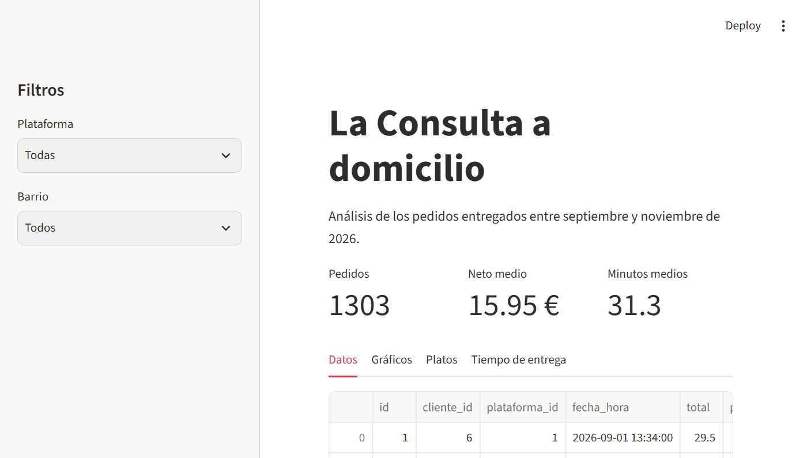

# La Consulta a domicilio

## De qué va el proyecto

Análisis de los pedidos a domicilio del bar La Consulta durante septiembre y octubre de 2026.

## Datos

Los datos proceden de una base de datos MySQL alojada en TiDB Cloud. Se han consultado los pedidos, plataformas, clientes, cartas, líneas de pedido y tiempo meteorológico.

## Limpieza

- Se convirtió el total a número.
- Se unificaron los formatos de fecha y hora.
- Los estados y barrios se normalizaron.
- Se eliminaron pedidos duplicados.
- Las propinas vacías se rellenaron con cero.
- Los minutos 0 y 999 se marcaron como huecos.
- Se añadieron fecha, hora, día, semana, neto y datos meteorológicos.
- Se separaron los pedidos entregados de los cancelados.

## Hallazgos

- Se entregaron 1.303 pedidos y se facturaron 27.880,60 € sin propinas.
- Teléfono tiene el neto medio más alto: 17,73 € por pedido.
- Rayo gestiona el mayor volumen, con 607 pedidos, frente a 400 de Mordisco y 296 de Teléfono.
- Chamberí concentra 484 pedidos entregados.

## Recomendación

Recomendamos mantener Rayo por su volumen, mantener Teléfono como canal propio y reforzar los repartos en Chamberí.

## App

Ejecuta la aplicación con:

`streamlit run app.py`
